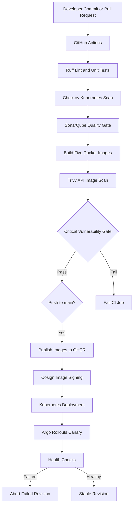

# Enterprise CI/CD Platform Architecture

## Workflow

## Components

- GitHub Actions: CI/CD orchestration.
- Ruff and unit tests: Python quality and behavior checks.
- Checkov: Kubernetes manifest security scanning.
- SonarQube Cloud: Code-quality analysis and quality-gate evaluation.
- Trivy: API image vulnerability scanning with a blocking CRITICAL gate.
- GHCR: Container image registry.
- Cosign: Container image digest signing.
- Kubernetes and Argo Rollouts: Deployment and rollout management.

## Limitations

- This is a portfolio demonstration using a local Kind cluster.
- The blocking Trivy gate applies to the API image only.
- Canary percentage steps are configured, but no traffic router is configured for actual percentage-based HTTP traffic splitting.
- A failed rollout can leave the Rollout resource Degraded even if the previous stable ReplicaSet remains healthy.
